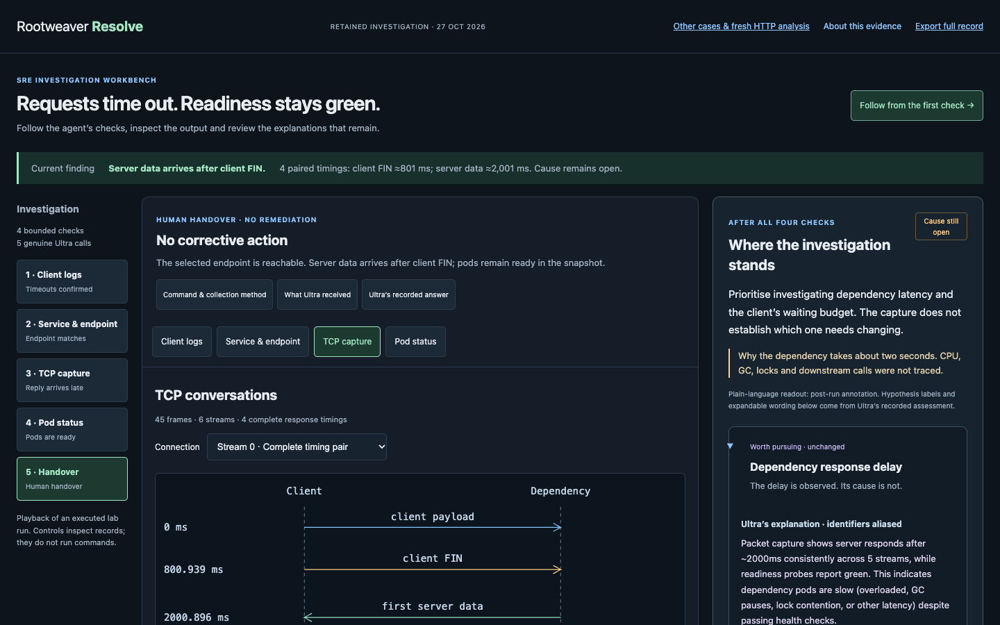

# Rootweaver Resolve 0.5.0

**An agent investigates. An SRE can inspect every check.**

[MIT license](LICENSE) · [Build and CI](docs/BUILD.md) · [Research and original outputs](research/README.md) · [Narrated review video](docs/media/resolve-05-ryan-review.mp4)



Resolve gives NVIDIA Nemotron 3 Ultra a bounded catalogue of debugging checks, gathers their outputs and shows how competing explanations change. The opening evidence workbench replays one genuine laboratory investigation: client timeouts, Service/EndpointSlice inspection, a scoped TCP capture and workload status. Ultra ran through Nebius Token Factory; Observe supervised packet acquisition. The human can inspect the method, complete output and unresolved questions.

## Start here — no credentials needed

Python 3.12 or newer; no runtime dependencies:

```sh
python3.12 -m venv .venv
.venv/bin/python -m pip install .
.venv/bin/resolve-demo
```

Open http://127.0.0.1:8766/ . The opening screen shows the completed investigation. Choose **Follow from the first check** to replay Logs → Service & endpoint → TCP capture → Pod status → Handover. Each step exposes the command, evidence available then and the next accepted model assessment. Later evidence is unavailable in earlier steps.

In thirty seconds: select **TCP capture**. Four complete timings show first server data around 2,001 ms after client payload, after client FIN around 801 ms. The selected endpoint is reachable. Neither the reason for the delay nor the correct client timeout has been established. Inspect Ultra's explanation and the visible reviewer qualifications.

The five genuine Ultra calls and four executed checks happened during the retained lab run. This exported workbench is playback: clicking it makes no provider or cluster request. Commands contain public aliases, so a human must substitute authorised targets to reproduce the method. A new capture observes a new time window. The application includes all 45 decoded frames, 74 captured log records, five model exchanges and the complete sanitised execution journal. This repository also includes the [original lab PCAP and unaliased model exchanges](research/packet-lab/README.md) for offline research inspection.

**Other cases & fresh HTTP analysis** opens the existing four-case console. Its seven historical model responses remain byte-identical. Its optional inference action below analyses a fixed HTTP evidence bundle; it does not run a new packet investigation. The earlier guided checks are authored navigation, whereas the packet investigation's four checks were selected by Ultra from a fixed catalogue.

## Run a fresh model analysis

On the **Other cases & fresh HTTP analysis** page, the **Ask Ultra about this evidence** panel is the runtime integration. It sends one fixed sanitised HTTP-case input to `nvidia/Nemotron-3-Ultra-550b-a55b` through Nebius Token Factory. Inspect the exact outgoing request before pressing **Run fresh analysis**. The result, original public response, input hash, usage, timestamps and independent retained finding are inspectable and exportable.

This is fresh inference on retained observations, **not new telemetry or autonomous collection**. The revised prompt is different from the original experiment; the resulting answer is not a controlled before/after evaluation. Historical responses and gate outcomes remain unchanged.

Create a private directory with mode 700 and a mode-600 key file containing one `NEBIUS_API_KEY=...` line, using your normal secure editor or secret provisioning. Do not put the key in browser storage, a command argument, source control or a public host. Choose a durable private state directory outside the repository. Then:

```sh
.venv/bin/resolve-demo --enable-live \
  --key-file /absolute/private/nebius.env \
  --state-dir /absolute/private/resolve-review-state \
  --freeze-sha256 "$(cat LIVE-FREEZE.sha256)"
```

Opening the page still makes no inference call. An explicit button starts one. The frozen package and request, fixed HTTPS provider, current model access/pricing checks, two durable reservations, 16,384-byte request bound, 4,096-token completion allowance, 120-second transport deadline and no retries bound this route. At the expected $1/$3 per million input/output tokens, the maximum two-call reservation is $0.065536; actual request reservations are displayed. Reservations persist after errors/restarts. Missing or inconsistent usage stops further calls. These are application controls, not account-wide billing limits. Do not delete state to bypass them.

The author's local verification also uses the existing signed-commit launch guard and shared programme ledger. Those private financial records and launch credentials are not distributed. The portable package's explicit digest verifies package integrity; it is not a claim of human approval or production certification. The older synthetic qualification runner and its signed guards remain separate and unchanged.

## What is actually demonstrated

- HTTP 500 despite Ready topology, with `InvalidOperation` in `calculate_checkout_total` present in the supplied logs. Identifying the named error is useful synthesis; its underlying cause and release attribution remain unproven.
- Selector mismatch: independently supported narrow selection mechanism; original incorrect Ready-only EndpointSlice assertion remains visible.
- DNS: actual NXDOMAIN and native resolver error; the historical input-window flaw and weak explanations are preserved.
- Client policy denial: source/control difference, one completed historical call, and a second request blocked before POST. The watchdog needed an in-run repair; the case remains HOLD.

Four cases and seven historical calls are a small case series. The first three categories contain six of those calls. Fresh integration checks do not increase the number of real fault categories or establish statistical reliability. No MTTR reduction, production qualification, autonomous remediation or superiority over an experienced SRE is claimed.

## Evidence and privacy

The workbench uses tool-specific readable projections by default: timestamped logs, Kubernetes resource tables and TCP conversations. Commands and complete outputs remain expandable. A contextual drawer shows collection methods, original model exchanges and exact model-facing inputs. Full exports never truncate captured lines. Post-run Codex editorial explanations are visibly separate from model answers and measured observations.

The packet case is a disclosed sanitised derivative, including its five model answers: private addresses, workload identifiers, response IDs, interface/container identities and machine paths are aliased. Model mistakes, timings, hypothesis polarity, source-row numbers and evidence references remain. Historical hashes identify the private original bytes, not the derivative. The public investigation manifest hashes all exported files. The seven older case-response strings were already suitable for public export and remain byte-identical. All private originals are unchanged.

Logs and packets were collected in different windows: the packet timings are not a correlation to those same six log requests. One stream begins mid-connection; another ends before a response. The model's five-pair claim and its unsupported timeout recommendation remain visible. The workbench is not a general claim validator or a production RCA system.

The standalone export needs no private Rootweaver services. No model weights or credentials are bundled. See [privacy](docs/PRIVACY.md), [limits](docs/LIMITATIONS.md) and the [existing four-case console architecture](docs/ARCHITECTURE.md). That architecture document describes the earlier console; the new workbench is a static replay of the separately retained model-selected investigation.

## Verify and build

```sh
.venv/bin/python -m unittest discover -s tests
node --test tests/*.mjs
.venv/bin/python -m pip install build
.venv/bin/python -m build
```

For the pinned toolchain, CI, custody verification and a clean-wheel smoke check, follow [Build and verify](docs/BUILD.md). Tests use simulated provider responses and synthetic controller fixtures where explicitly labelled. They make no inference calls. See the separate retained verification receipt for genuine integration outcomes. Install the wheel into a clean environment to verify the packaged assets. The local server binds only to loopback. Hosting requires a separately reviewed gateway/access/budget plan; see [publication handoff](docs/PUBLICATION-HANDOFF.md).

## Review candidate, not published

The repository is prepared at [rduffyuk/rootweaver-resolve](https://github.com/rduffyuk/rootweaver-resolve), **private for owner review**. Public repository access, a judge-facing working demo/test-build URL and the public YouTube video remain pending owner approval. The current narrated review video uses Ryan Duffy's own recording, aligned to actual browser footage. The editable script and corrected captions are retained; the earlier synthetic-voice cut was rejected. A local loopback URL is not a judge-facing URL.

Rootweaver predates the competition. Resolve's application, inference integration, evidence controls and visual investigation flow are competition-period work. Ryan Duffy owns the problem, design and acceptance; OpenAI Codex assisted implementation and verification. NVIDIA Nemotron produced the actual AI analyses through Nebius Token Factory. No fine-tuning was performed. MIT covers this prepared standalone slice. See LICENSE, SOURCE-ORIGINS.json, [license and attribution](docs/LICENSE-AND-ATTRIBUTION.md) and [development disclosure](docs/DEVELOPMENT-DISCLOSURE.md).
