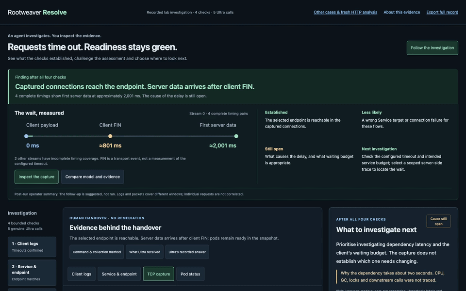
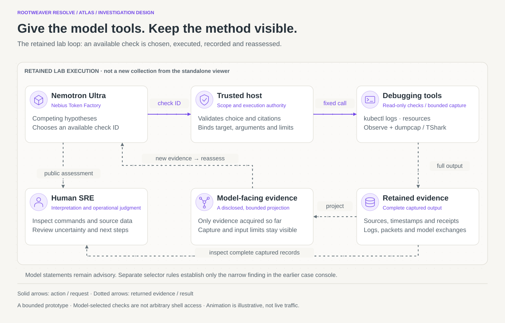

# Rootweaver Resolve

**An agent investigates. You inspect the evidence.**

NVIDIA Nemotron 3 Ultra chooses bounded debugging checks. Resolve puts the command,
readable output and changing assessment side by side, so an SRE can decide what to
investigate next.

[**Run locally →**](#start-here--no-credentials-needed) · [**Watch Ryan’s 2:18 demo →**](docs/media/resolve-05-ryan-review.mp4) · [**Explore the architecture →**](docs/ARCHITECTURE.md)

[MIT](LICENSE) · Python 3.12+ · No runtime dependencies · Version 0.5.0 · Private review candidate



*Actual browser footage from a retained laboratory investigation. Playback makes no
new model call or cluster request. [Full desktop view](docs/media/desktop-overview.png) · [Mobile assessment](docs/media/mobile-assessment.png)*

## Understand it in thirty seconds

1. **Inspect TCP capture.** The selected endpoint is reachable. Four complete timings
   show first server data around **2,001 ms**, after the client FIN around **801 ms**.
2. **Compare the explanation.** Ultra narrows the investigation, but overcounts the
   timings and recommends a timeout change without seeing its configuration.
3. **Challenge the conclusion.** Open the method, original output and qualifications.
   The underlying latency cause and correct timeout remain unresolved.

That is the useful handover: the checks already done, the evidence that changed the
assessment, and the uncertainty an operator still needs to resolve.

## Start here — no credentials needed

Clone or extract this repository first. Python 3.12 or newer; no runtime dependencies:

```sh
python3.12 -m venv .venv
.venv/bin/python -m pip install .
.venv/bin/resolve-demo
```

Open **http://127.0.0.1:8766/**. Choose **TCP capture** for the payoff, or **Follow from
the first check** for the full investigation. For cloning, pinned build tools and CI,
see [Build and verify](docs/BUILD.md).

<details>
<summary>What the replay includes, collection windows and original research artifacts</summary>


Open http://127.0.0.1:8766/ . The opening screen shows the completed investigation. Choose **Follow from the first check** to replay Logs → Service & endpoint → TCP capture → Pod status → Handover. Each step exposes the command, evidence available then and the next accepted model assessment. Later evidence is unavailable in earlier steps.

In thirty seconds: select **TCP capture**. Four complete timings show first server data around 2,001 ms after client payload, after client FIN around 801 ms. The selected endpoint is reachable. Neither the reason for the delay nor the correct client timeout has been established. Inspect Ultra's explanation and the visible reviewer qualifications.

The five genuine Ultra calls and four executed checks happened during the retained lab run. This exported workbench is playback: clicking it makes no provider or cluster request. Commands contain public aliases, so a human must substitute authorised targets to reproduce the method. A new capture observes a new time window. The application includes all 45 decoded frames, 74 captured log records, five model exchanges and the complete sanitised execution journal. This repository also includes the [original lab PCAP and unaliased model exchanges](research/packet-lab/README.md) for offline research inspection.

**Other cases & fresh HTTP analysis** opens the existing four-case console. Its seven historical model responses remain byte-identical. Its optional inference action below analyses a fixed HTTP evidence bundle; it does not run a new packet investigation. The earlier guided checks are authored navigation, whereas the packet investigation's four checks were selected by Ultra from a fixed catalogue.

</details>

## What runs where

| Path | What happens | What is required |
|---|---|---|
| Default evidence workbench | Replays five genuine Ultra exchanges and four executed lab checks; no new requests | Local Python installation |
| Fresh HTTP analysis | Sends fixed retained HTTP evidence to Ultra; no new telemetry | Explicit opt-in, your Nebius key and durable call budget |
| Original lab investigation | Ultra selected checks; Observe supervised collection; a human received the unresolved handover | Retained research records; the private collector is not a standalone runtime |

## Run a fresh model analysis

The separate **Other cases & fresh HTTP analysis → Ask Ultra about this evidence**
panel provides the opt-in Nebius runtime integration. It is disabled by default.
[Read the exact setup, request bounds, reservations and failure handling](docs/FRESH-ANALYSIS.md).

## Follow the investigation through the architecture



[Source map and all three animated diagrams](docs/ARCHITECTURE.md) · [Static version](docs/diagrams/investigation-loop.static.svg)

## Find what you need

| You want to… | Start here |
|---|---|
| Install, test or reproduce the build | [Build and CI](docs/BUILD.md) |
| Inspect original experiments, mistakes and model outputs | [Research archive](research/README.md) |
| Understand what is and is not established | [Limitations](docs/LIMITATIONS.md) |
| Review evidence transformations and attribution | [Privacy](docs/PRIVACY.md) · [Development disclosure](docs/DEVELOPMENT-DISCLOSURE.md) |
| Contribute a reproducible issue or change | [Contribution guide](CONTRIBUTING.md) |
| Review submission copy, video and artwork | [Submission review pack](docs/SUBMISSION-REVIEW.md) |

<details>
<summary>Earlier fault cases and evaluation limits</summary>

## What is actually demonstrated

- HTTP 500 despite Ready topology, with `InvalidOperation` in `calculate_checkout_total` present in the supplied logs. Identifying the named error is useful synthesis; its underlying cause and release attribution remain unproven.
- Selector mismatch: independently supported narrow selection mechanism; original incorrect Ready-only EndpointSlice assertion remains visible.
- DNS: actual NXDOMAIN and native resolver error; the historical input-window flaw and weak explanations are preserved.
- Client policy denial: source/control difference, one completed historical call, and a second request blocked before POST. The watchdog needed an in-run repair; the case remains HOLD.

Four cases and seven historical calls are a small case series. The first three categories contain six of those calls. Fresh integration checks do not increase the number of real fault categories or establish statistical reliability. No MTTR reduction, production qualification, autonomous remediation or superiority over an experienced SRE is claimed.


</details>

<details>
<summary>Evidence, privacy and complete forensic records</summary>

## Evidence and privacy

The workbench uses tool-specific readable projections by default: timestamped logs, Kubernetes resource tables and TCP conversations. Commands and complete outputs remain expandable. A contextual drawer shows collection methods, original model exchanges and exact model-facing inputs. Full exports never truncate captured lines. Post-run Codex editorial explanations are visibly separate from model answers and measured observations.

The packet case is a disclosed sanitised derivative, including its five model answers: private addresses, workload identifiers, response IDs, interface/container identities and machine paths are aliased. Model mistakes, timings, hypothesis polarity, source-row numbers and evidence references remain. Historical hashes identify the private original bytes, not the derivative. The public investigation manifest hashes all exported files. The seven older case-response strings were already suitable for public export and remain byte-identical. All private originals are unchanged.

Logs and packets were collected in different windows: the packet timings are not a correlation to those same six log requests. One stream begins mid-connection; another ends before a response. The model's five-pair claim and its unsupported timeout recommendation remain visible. The workbench is not a general claim validator or a production RCA system.

The standalone export needs no private Rootweaver services. No model weights or credentials are bundled. See [privacy](docs/PRIVACY.md), [limits](docs/LIMITATIONS.md) and the [visual architecture](docs/ARCHITECTURE.md), which separates the retained lab loop, the case console and the standalone runtime.


</details>

<details>
<summary>Verification details</summary>

## Verify and build

```sh
.venv/bin/python -m unittest discover -s tests
node --test tests/*.mjs
.venv/bin/python -m pip install build
.venv/bin/python -m build
```

For the pinned toolchain, CI, custody verification and a clean-wheel smoke check, follow [Build and verify](docs/BUILD.md). Tests use simulated provider responses and synthetic controller fixtures where explicitly labelled. They make no inference calls. See the separate retained verification receipt for genuine integration outcomes. Install the wheel into a clean environment to verify the packaged assets. The local server binds only to loopback. Hosting requires a separately reviewed gateway/access/budget plan; see [publication handoff](docs/PUBLICATION-HANDOFF.md).


</details>

## Review candidate, not published

The repository is prepared at [rduffyuk/rootweaver-resolve](https://github.com/rduffyuk/rootweaver-resolve), **private for owner review**. Public repository access, a judge-facing working demo/test-build URL and the public YouTube video remain pending owner approval. The current narrated review video uses Ryan Duffy's own recording, aligned to actual browser footage. The editable script and corrected captions are retained; the earlier synthetic-voice cut was rejected. A local loopback URL is not a judge-facing URL.

Rootweaver predates the competition. Resolve's application, inference integration, evidence controls and visual investigation flow are competition-period work. Ryan Duffy owns the problem, design and acceptance; OpenAI Codex assisted implementation and verification. NVIDIA Nemotron produced the actual AI analyses through Nebius Token Factory. No fine-tuning was performed. MIT covers this prepared standalone slice. See LICENSE, SOURCE-ORIGINS.json, [license and attribution](docs/LICENSE-AND-ATTRIBUTION.md) and [development disclosure](docs/DEVELOPMENT-DISCLOSURE.md).
