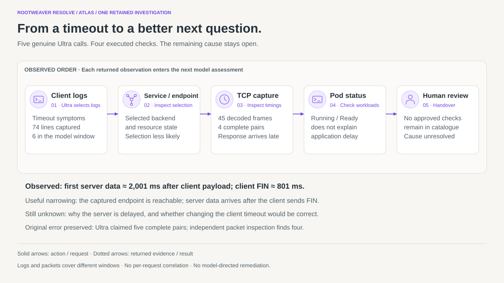
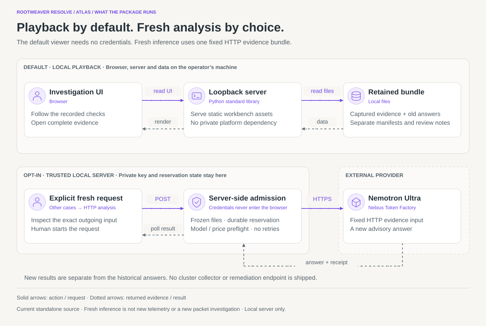

# Resolve architecture and investigation flow

Resolve makes an investigation inspectable: the model proposes a bounded check,
the host controls execution, and the SRE can inspect the evidence and its limits.
The retained lab collector and the standalone viewer have different runtime scopes.

[Open all three animated views](diagrams/index.html) · [Diagram source and static exports](diagrams/README.md)

## 1. How the retained investigation works

Ultra can choose only an available check ID. The host fixes targets and arguments,
validates the response and references, then runs the bound collector. Complete
captured output is retained separately from the bounded projection sent to the
model. The next answer can revise competing hypotheses; it cannot turn its prose
into a controller-supported cause. The human reviews the commands, source output,
public explanation and unresolved questions.

This view describes the **historical lab loop**, whose implementation is supplied
as [source reference](../reference/retained-investigation/README.md). The portable
workbench replays its records; it does not install the private Observe deployment
or host adapters. In the earlier case console, separate deterministic selector
rules establish only a narrow resource-selection finding, not application health
or complete incident causality. This separation prevents a plausible model answer
from becoming execution or evidence authority.

## 2. What the real packet investigation established

Logs → Service/EndpointSlice → TCP capture → Pod status → handover is the retained
model-selected order. The packet path used Observe-supervised dumpcap and TShark,
not Kubeshark or eBPF. Four complete timings show first server data after the client
has sent FIN. The original five-pair model overcount remains in the archive.

This supports reachability and late response in that window. It does not identify
why the server was slow or prove that increasing a timeout is the correct action.
The logs and packets came from different windows. Handover follows exhaustion of
the fixed catalogue; it is not a claim of general autonomous stopping judgment.
See [original packets and reproduction commands](../research/packet-lab/README.md).

## 3. What runs in the standalone package

Opening the viewer reads local assets through a loopback Python server. It makes
no cluster or provider request. The separate fresh-analysis route needs explicit
startup opt-in and a human button press. It inspects a frozen HTTP evidence bundle,
checks package/request integrity, reserves the call durably and contacts the fixed
Nebius endpoint. A new answer and receipt stay separate from historical records.
No arbitrary model-supplied command or fresh packet collection is exposed here.

The credential remains server-side. Admission rejects busy/over-budget, changed
input and accounting-hold states. A provider or usage failure does not trigger an
automatic retry or erase the reservation; uncertainty about consumption remains
visible. This is a local prototype, not an operating-system sandbox or multi-user
service. Browser disconnection is not authority to repeat an inference call.

## Source and evidence map

| Statement | Source or retained evidence |
|---|---|
| Fixed available checks and public hypothesis schema | [investigation_session.py](../reference/retained-investigation/investigation_session.py), `SYSTEM`, `response_format`, `Check`, `InvestigationSession` |
| Original ordering, model requests and results | [session.json](../src/rootweaver_resolve/workspace/data/investigation/session.json), `steps` and `execution_journal`; [unaliased exchanges](../research/packet-lab/) |
| Supervised capture and timing projection | [deep_capture.py](../reference/retained-investigation/deep_capture.py); [original capture](../research/packet-lab/capture.pcapng) |
| Independent narrow selector support | [support.py](../src/rootweaver_resolve/support.py), [controller.py](../src/rootweaver_resolve/controller.py) |
| Loopback/same-origin HTTP boundary | [retained_workspace.py](../src/rootweaver_resolve/retained_workspace.py), `Handler`, `main`, `serve` |
| Frozen inputs, reservation, preflight and failure states | [fresh_analysis.py](../src/rootweaver_resolve/fresh_analysis.py), `verify_freeze`, `FreshAnalysis.submit`, `_run` |
| Displayed post-run correction and evidence-window limits | [review-notes.json](../src/rootweaver_resolve/workspace/data/investigation/review-notes.json), [methodology](../research/METHODOLOGY.md) |

The diagrams illustrate source-verified responsibilities and historically retained
execution. Motion is a reading aid, not an observation of traffic or timing. Their
JSON models, native SVGs, static exports and Mermaid companions share one owner
here. Existing evidence, source modules and evaluation records are unchanged.

## Earlier case-console and fresh-analysis contract

The original detailed explanation below is retained. Its “historical path” refers
to the controlled-fault case series; the model-selected packet loop is described
separately above.

Historical path: controlled disposable fault → Observe / independent client acquisition → complete retained source → bounded model-facing selection → genuine earlier Nebius inference → unchanged public response. Deterministic selector-support rules independently evaluate typed resource observations. The graph shows resource associations, not traced traffic.

Presentation: the standard-library loopback server serves the sanitised case bundle; plain JavaScript renders the guided investigation and accessible evidence drawer. No private Rootweaver service is required. The broader Observe platform and experiment watchdog are not distributed.

Opt-in 0.4.0 path: exact fixed HTTP-case request inspection → explicit same-origin POST → frozen-file verification → durable two-call reservation → model/pricing preflight → fixed Nebius HTTPS completion → complete public response plus receipt → advisory hypothesis cards. The trusted server alone reads the private key. The UI polls a run ID; a disconnected browser cannot trigger an automatic retry. Model output has no route to collect data, execute code or mutate controller findings. Usage inconsistency fails closed. The private review launcher adds the existing signed Git/check guard and shared programme accounting.

The two paths have separate records. A fresh run never edits the seven original outputs or historical evaluation dispositions. The displayed independent finding is labelled retained. Public observations have different bytes from private originals; original IDs remain cross-references, with separate public hashes. This package is a local application/test build, not a production multi-user service or durable distributed audit platform.
