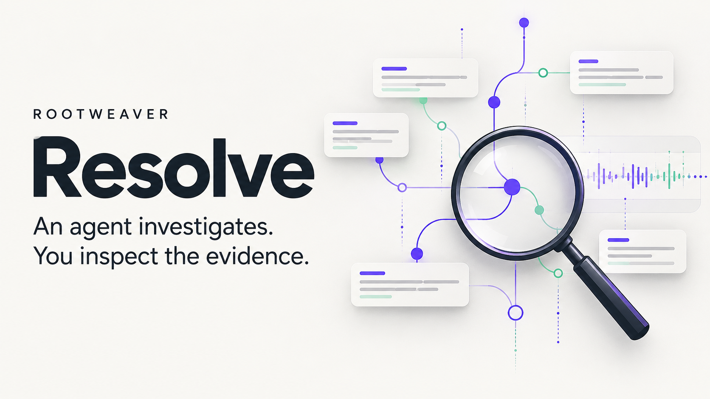

# Submission review pack — Resolve 0.5.0

Prepared on 29 October 2026 for the Nebius x NVIDIA Global AI Hackathon.
**Owner review. Repository/video publication and final submission remain on hold.**

**Project-page visibility:** Devpost's general editor published the project
page on Save. It is hidden from the portfolio, but the owner subsequently accepted continuing to edit it; see the status below. Do not describe this package as wholly unpublished.

The official deadline is **30 October 2026, 17:00 UTC / London time**.
[Official event](https://nebiusglobalaihackathon.devpost.com/) ·
[Requirements](https://nebiusglobalaihackathon.devpost.com/rules)

[Devpost draft](https://devpost.com/software/rootweaver-resolve) is saved with the
project story, technologies, repository link, cover and three actual screenshots.
Eleven technical/free-text answers plus track and Tavily selection were saved and
read back. Proposed ratings still say owner review. Personal declarations and
publication-dependent URL fields remain incomplete.
The hackathon entry remains DRAFT with no submitted date. During this polish pass,
saving the gallery through Devpost's general project editor unexpectedly changed
the project page to `published` at 20:18:58 UTC. It was immediately hidden from
the owner's portfolio; that does not restore draft visibility. The owner subsequently accepted keeping and editing this page; no support request was sent. The private repository
and private review video remain separate from this project-page state.
[YouTube review](https://youtu.be/WQ6nVurVR9Q) is **Private** with thumbnail and captions.

## Open these first

1. [Ryan's 2:18 demonstration](media/resolve-05-ryan-review.mp4)
2. [Devpost story](../devpost-submission.md)
3. [All official form answers](DEVPOST-FIELDS.md)
4. [YouTube title, description and chapters](YOUTUBE-UPLOAD.md)
5. [Build and verify](BUILD.md), [original research](../research/README.md) and
   [animated architecture](ARCHITECTURE.md)

## Cover candidate

## Proposed Devpost gallery

| Order | File | Caption |
|---|---|---|
| Cover | [Resolve cover](media/resolve-cover.png) | An agent investigates. You inspect the evidence. Conceptual branding. |
| 1 | [Desktop workbench](media/desktop-overview.png) | The measured finding, proportional packet timing and four-part operator handover upfront. Genuine retained execution; playback does not make new calls. |
| 2 | [Model and evidence](media/comparison-desktop.png) | The measured capture beside two post-run reviewer qualifications. These are not automatic corrections. |
| 3 | [Mobile comparison](media/comparison-mobile.png) | Compare the model assessment with retained evidence in a mobile viewport. Physical-phone validation remains separate. |
| 4, optional | [Evidence artwork](media/resolve-evidence-art.png) | Follow the checks. Challenge the conclusion. Conceptual illustration, not a product screenshot. |

## Publication decisions still needed

- Approve the video, captions and thumbnail after viewing the private upload.
- Approve public repository visibility and an anonymously accessible test-build
  URL. A local preview and a private GitHub Actions artifact do not satisfy this.
- Decide whether the downloadable test build with the documented opt-in runtime
  meets the desired judge experience, or whether a hosted replay is also wanted.
  Fresh inference needs the operator's own key; the retained packet collector is
  not portable. Do not claim a hosted live agent or automatic new collection.
- Confirm submitter identity/residence, existing-project disclosure, eligibility
  declarations and subjective feedback ratings in the field packet.
- Authorise the final Devpost submission separately.

## Review criteria

The thirty-second path is **measured finding → compare model and evidence →
next investigation**. The revised video opens on the measured timing diagram and
shows the model/evidence comparison from approximately seven seconds. It then
follows Ryan's unchanged narration through the original check sequence. The fuller
spoken timing explanation remains around 61 seconds.

Keep the story focused on inspectable debugging and a useful human handover.
Do not claim reliable autonomous RCA, improved MTTR, calibrated confidence,
production qualification or superiority from this small case series.
